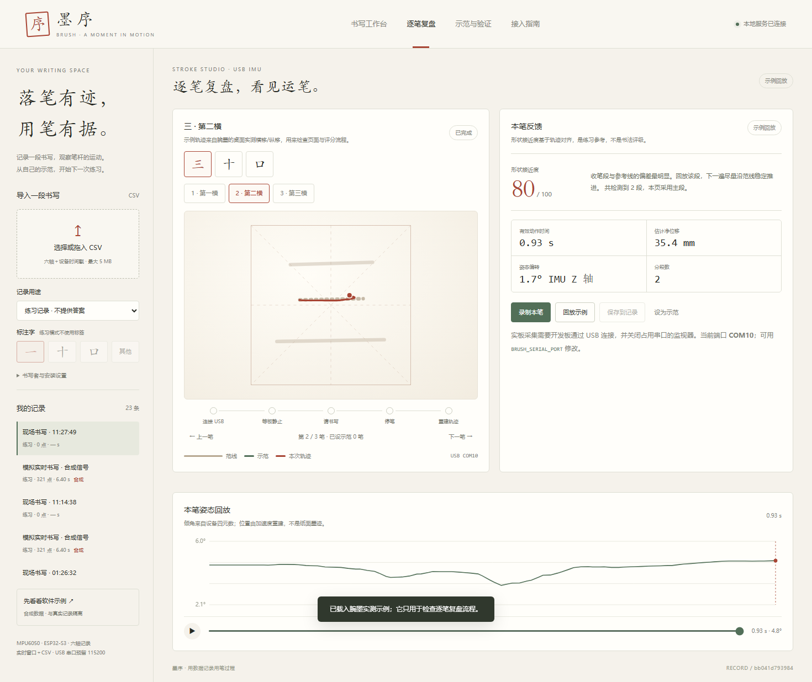

# 腕上运笔 · Snowline / 墨序 / 腕墨

用一块 ESP32-S3 + MPU6050 记录手腕运动，把连续的书写动作变成可回放、可比较的数据。
仓库包含固件、两个上位机 Web 应用，以及逐笔 USB 采集与形状评分。

## 目录

| 路径 | 内容 |
| --- | --- |
| `src/`、`platformio.ini` | ESP32-S3 N16R8 固件：MPU6050 采样、卡尔曼姿态、OLED、USB TRACE、Wi-Fi 测试包 |
| `tools/web_console.py`、`tools/web/` | Snowline 滑雪控制台（实时六轴、CSV 录制、Wi-Fi 链路测试） |
| `tools/ink_coach.py`、`tools/ink_web/` | 腕墨 · 书法动作复盘（USB 单笔采集、轨迹重建、形状接近度） |
| `毛笔书写识别与用笔过程记录/` | 墨序 · 毛笔书写工作台（FastAPI + SQLite，六轴记录分析、复核与逐笔复盘） |

## 墨序工作台

```bash
cd 毛笔书写识别与用笔过程记录
python -m pip install -r requirements.txt
python run.py
```

打开 <http://127.0.0.1:8765/>；逐笔复盘也可以直接访问
<http://127.0.0.1:8765/strokes>。

- `BRUSH_SERIAL_PORT`：开发板串口，默认 `COM10`（Windows）/ `/dev/ttyACM0`（Linux）。
- `BRUSH_TIP_MM`：IMU 到笔尖的机体系偏移，形如 `0,0,30`，用于轨迹重建。
- `BRUSH_API_TOKEN`：局域网访问时至少 16 位的接口令牌；本机默认留空。
- `BRUSH_DATA_DIR`：记录目录，默认 `毛笔书写识别与用笔过程记录/data`。

测试：

```bash
cd 毛笔书写识别与用笔过程记录
python -m pytest tests -q
```



逐笔复盘把腕墨的 USB 采集流程并入了墨序：

1. 板子通过 USB 连续输出 900 帧 TRACE；
2. 用零速约束重建笔尖平面轨迹；
3. 将实测轨迹与范线（或个人示范）重采样、旋转对齐后计算形状接近度。

评分只表示轨迹与参考线的形状接近程度，用于练习反馈，不是书法评级，也不代表真实笔尖墨迹。

## 腕墨复盘站

```bash
python tools/ink_coach.py --host 127.0.0.1 --port 8766 --serial-port COM10
```

打开 <http://127.0.0.1:8766/>。

## Snowline 控制台

```bash
python tools/web_console.py --host 127.0.0.1 --port 8877
```

## 固件

```bash
pio run -e esp32s3-n16r8-imu-usb -t upload
```

USB 采集协议（115200 波特率）：

```text
TRACE            # 立即开始 900 帧采样
TRACE_ARM        # 等板端确认静止后再开始
TRACE_BEGIN,n
TRACE,<序号>,<时间戳us>,<q0>,<q1>,<q2>,<q3>,<世界系加速度x/y/z>,<角速度模长>,<静止>,<削顶>,<gx原始>,<gy原始>,<gz原始>
TRACE_DONE
```

原始陀螺值除以 65.5 得到 °/s。Wi-Fi 链路测试使用 `POST /api/wifi-test`。

## 数据说明

`data/`、`recordings/`、`output/`、`.pio/` 和各类构建产物不会提交。
`data/` 中的 SQLite 数据库与 `recordings/` 中的原始 CSV 属于本机采集数据，请按需单独备份。
