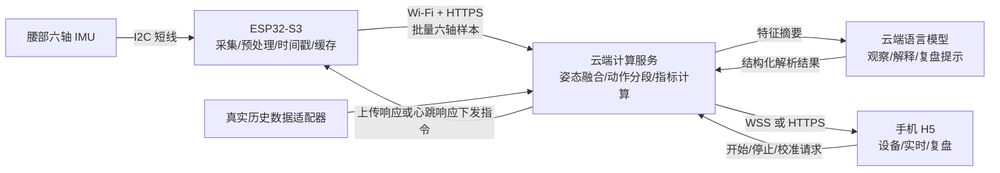

# IMU 边缘穿戴设备：技术路线与硬件清单 v1

日期：2026-11-07。此文件汇总当前技术目标，作为首版实现依据。此前的《滑雪穿戴设备_Demo实施方案》《开源方案筛选与联调路线》用于指标细节和源码参考；若交互端或任务分工描述不同，以本文为准。

Windows 上的 VS Code 和 PlatformIO 已配置。COM8 已通过局域网 Wi-Fi 验证，COM10 测试板已接入 MPU6050 和 OLED，实机姿态上报和网页主动探测已通过（见第 8.1 至 8.3 节）。云端部署待验证。12–15 小时是开发目标，假设硬件到位、已有可用云端环境与模型账号。

## 1. 首版范围与推荐配置

**一颗腰部六轴 IMU + 已有 ESP32-S3 N16R8 + 已有 5 V 电源 + Wi-Fi 云端解析 + 手机 H5 交互。**

| 项目 | 首版决定 |
| --- | --- |
| 传感来源 | 仅使用穿戴节点 IMU 的三轴加速度与三轴角速度；手机只负责交互和可选网络热点 |
| IMU 数量 | 装机一颗；可另备一颗同型号模块用于替换 |
| 佩戴位置 | 腰后/骨盆附近；记录安装方向；首版观察通用动作，不先区分单双板动作类别 |
| 板端职责 | 采集、时间戳、单位转换、必要前端滤波、可选零偏、异常标记、缓存和上传 |
| 云端职责 | 姿态融合、动作分段、指标计算、数据记录、模型解析与复盘 |
| 手机端 | 手机网页 H5，用户已接受；同一网页适配电脑投屏 |
| 网络主线 | ESP32-S3 作为 Wi-Fi 客户端，直接连接云端；手机网页也连接云端 |
| 现场环境 | 室内报告厅；实时佩戴动作 + 来源和字段已核验的数据回放 |

## 2. 总体技术路线



第一版可用手机的 **2.4 GHz 热点**给 ESP 提供互联网，手机浏览器使用同一手机的网络访问云端页面。热点只负责网络转发，H5 页面不承担原始数据转发，也无需直接访问 ESP 的局域网地址。现场要实际验证所用手机的热点频段与互联网连通性。

ESP32-S3 原生支持 2.4 GHz Wi-Fi 和 BLE，首版使用 Wi-Fi，后续需要手机近场接入时可改为 BLE 网关路线，当前无需增加通信模块。[Espressif 产品说明](https://www.espressif.com/en/products/socs/esp32-s3)、[Arduino Wi-Fi API](https://docs.espressif.com/projects/arduino-esp32/en/latest/api/wifi.html)。

### 为什么首版这样连接

- 当前最需要的是传感、解析和交互闭环，Wi-Fi 直连让云端直接获得完整样本。
- H5 通过普通 HTTPS/WSS 与云端交互；Android 和 iPhone 均可作为验证目标，以所用真机浏览器实测为准。
- 增加原生 App 或 BLE 中转时，可以继续复用六轴数据格式和云端指标接口。
- 网页切后台或锁屏时可能断开实时连接；首版按前台演示设计。页面关闭后，已经启动的设备会话仍由 ESP 和云端状态管理，不能依赖网页计时器维持采样。

## 3. 板端预处理方案

开发建议：Arduino/C++，使用熟悉的构建环境；传感器采用 [Adafruit_LSM6DS](https://github.com/adafruit/Adafruit_LSM6DS) 中与实际芯片一致的驱动。

### 3.1 初始参数

| 参数 | 首版建议 | 说明 |
| --- | --- | --- |
| IMU 输出频率 | 104 Hz，LSM 系列对应档位 | 按新样本/DRDY/FIFO 读取；不是重复读取旧数据 |
| 加速度量程 | ±8 g | 如出现饱和改 ±16 g，并记录设置变更 |
| 角速度量程 | ±1000 °/s | 如出现饱和改 ±2000 °/s，并记录设置变更 |
| 传感器低通 | 约 20 Hz，以可用硬件档位为准 | 参数写入元数据；避免多层重复滤波造成不明延迟 |
| I²C | 先 100 kHz 调通，再按实际稳定性使用 400 kHz | 短线、3.3 V 逻辑、共地 |
| 样本时间 | 64 位启动后单调微秒时间 | 网络到达时间不能代替采样时间 |
| 上传批次 | 每 100–200 ms，约 10–21 个样本 | 优先复用连接，发送任务与采集任务分离 |
| 数据缓存 | 目标约 60 秒，有界缓存 | 启动检查 PSRAM；溢出时记录缺口 |

这些是调试起点，不是滑雪应用的已验证最佳参数。若采用不同 IMU，使用其实际支持的采样档位，并修改元数据。

当前已有的 MPU6050 测试板沿用原工程的 100 Hz、±2 g、±500 °/s 配置。该板的接线、烧录目标与联调口径见第 8.3 节。

### 3.2 预处理步骤

1. 读取六轴数据，保留采样时间和递增序号。
2. 转成统一单位：加速度 m/s²，角速度 °/s。
3. 检测量程饱和、通信失败和采样缺口；失败样本不得用全零伪装为正常数据。
4. 可选在静止时估计陀螺零偏；上传校准值与是否已扣除标记，云端不得再次扣除。
5. 将样本放入有界队列，通信任务批量上传并处理确认与重试。

首版主要上传完整六轴观测，不提前压缩成几个均值，也不只保留 10 Hz 看板数据。这样云端可以调整融合、滤波和分段策略。板端不承担专用动作模型训练或语言模型解析。

若一条二进制原始记录按 32 字节封装，一颗 IMU 在 104 Hz 下约 3.3 kB/s，60 秒约 0.20 MB；JSON 与协议开销另计。这是格式估算，不是当前设备实测吞吐。

## 4. 云端解析方案

### 4.1 技术栈

| 功能 | 首版实现 |
| --- | --- |
| API 与设备接入 | Python FastAPI，HTTPS |
| 姿态算法 | x-io Fusion 的 Python 包 imufusion；逐设备、逐 IMU 保持状态 |
| 信号与统计 | NumPy + 简单状态机；需要时增加 SciPy |
| 数据记录 | JSONL 原始记录 + 会话元数据；单实例 Demo 不先增加独立数据库 |
| 实时结果 | WSS，约 5–10 Hz 输出姿态；汇总指标约 1 Hz |
| 自然语言解析 | 已可访问的模型 API，输入指标摘要，输出观察、证据、提示和局限 |
| 部署 | 一个支持 HTTPS/WSS、持续运行的云端 CPU 服务；先复用已有资源，不预设必须使用 GPU |

Fusion 可处理仅加速度与陀螺的六轴输入，提供姿态和相关算法状态；单位、采样率、坐标和版本接口必须与其示例匹配。[官方 Fusion 项目](https://github.com/xioTechnologies/Fusion)。FastAPI 可提供 [WebSocket](https://fastapi.tiangolo.com/advanced/websockets/) 和 [静态网页](https://fastapi.tiangolo.com/tutorial/static-files/)，首版把 H5 与 API 放在同一服务域名，减少额外部署工作。

### 4.2 三层解析

**第一层：信号与姿态。**检查单位、安装方向、校准与时间连续性；在云端逐样本融合，输出相对中立姿态的侧倾/前后倾估计。持续动态加速度会影响六轴姿态，绝对航向不能长期无漂移。

**第二层：动作与指标。**用阈值、持续时间和回到中立的条件分段；计算动作数、节奏、节奏 CV、左右动作幅度差异。这里使用确定的程序逻辑，不让语言模型凭原始数列猜数值。

**第三层：模型解释。**将已计算的数值、样本数、位置和质量状态交给模型，生成可追溯的复盘。首版不需要训练专用深度学习模型；真实数据达到字段、标签和独立验证条件后，再引入专用分类器。

SkiC-LSTM 可作为后续滑雪分段参考，但现有权重依赖其原始手机特征与安装位置，不直接用于当前腰部六轴实时数据。详见 [开源方案筛选与联调路线](开源方案筛选与联调路线.md)。

已补充核对 AnyMo、UniMTS、LIMU-BERT 和 KineSpan 等公开预训练模型，具体资产、输入与限制见同文第 9 节。它们是可选模型分支，当前尚未决定或完成部署；首版一颗腰部 IMU、ESP 预处理、云端指标与手机 H5 的主线保持为实施基准。

### 4.3 首版指标口径

| 指标 | 计算口径 | 最低输出条件 |
| --- | --- | --- |
| 会话时长 | 设备确认开始到结束的记录时长 | 有明确会话状态 |
| 相对侧倾角 | 云端融合后相对中立姿态的 roll | 校准完成、样本连续、姿态有效 |
| 前后倾估计 | 同上，对应 pitch | 同上；可放在详情页 |
| 左右动作次数 | 超过单侧阈值、满足持续时间并返回中立的完整事件 | 有效幅度与质量条件通过 |
| 动作节奏 | 相邻交替事件峰值时刻的间隔 | 至少 6 个有效间隔 |
| 节奏 CV | `100 × std(T) / mean(T)` | 同上；跳过跨暂停/缺口的间隔 |
| 左右幅度差异 | `100 × |μL−μR| / (μL+μR)` | 两侧各至少 5 次，幅度高于噪声 |
| 数据质量 | 校准、缺口、饱和、最近数据时间 | 始终展示；不足时相关指标为 null |

一颗腰部 IMU 可以观察该节点的左右动作差异，但不能分别测量左右腿运动或受力。此方案不把惯性积分作为可靠速度/距离，不把腰部角度称为雪板立刃角，也不输出未经验证的疲劳度和技术等级。

## 5. 手机 H5 交互

实现建议：原生 HTML/CSS/JavaScript + Apache ECharts，使用响应式布局。先完成能在手机浏览器使用的单页三标签界面；有余量再加桌面图标等 PWA 体验。[ECharts 官方入门](https://echarts.apache.org/handbook/en/get-started/)。

| 页面/标签 | 主要内容与操作 |
| --- | --- |
| 设备与校准 | 设备号、在线/断流状态、佩戴位置、校准结果；开始/停止/校准按钮 |
| 实时监测 | 侧倾曲线、动作数、节奏、左右幅度差异、质量标记；少量前后倾详情 |
| 会话复盘 | 会话摘要、上组与本组对比、生成复盘按钮、模型观察及证据；可选择已核验记录回放 |

交互要求：

- 用户点击开始后显示“等待设备确认”，收到设备确认才进入记录中状态。
- 校准由云端下发任务，设备采集静止样本，云端检查与设定姿态参考；失败时提示重新静止。
- 模型解析异步执行；显示处理中和结果来源，不能阻塞实时指标。
- 网络中断时显示最近更新时间，旧值不能继续显示为实时；恢复连接后重新获取会话状态。
- 模型超时用规则摘要回退并标明来源；回放明确标记为历史记录。
- 图表只绘制最近约 30–60 秒的低频显示数据，原始样本在云端保存，避免手机无限累积图表点。

## 6. 数据与指令接口

### 6.1 建议接口

| 接口 | 用途 |
| --- | --- |
| `POST /api/device/batches` | ESP 上传样本，响应返回确认序号及待执行指令 |
| `POST /api/device/heartbeat` | 未采集时报告状态并接收开始/校准指令；约每秒一次 |
| `POST /api/device/acks` | 上报指令接收/执行状态；也可合并进批次元数据 |
| `POST /api/sessions` | H5 创建会话并请求开始 |
| `POST /api/devices/{id}/commands` | H5 请求停止、校准等操作 |
| `GET /api/sessions/{id}` | 会话当前状态、指标和复盘 |
| `POST /api/sessions/{id}/review` | 异步生成模型复盘 |
| `WSS /ws/sessions/{id}` | 云端向 H5 推送姿态、指标和状态 |

这是项目自定义协议。手机不需要通过蓝牙直接控制节点；设备通过上传/心跳响应取得云端指令。每个指令有独立 `command_id`，设备去重执行并返回确认，避免重试导致重复开始/校准。

### 6.2 样本协议示例

下例为虚构协议示例，不是用户实测记录：

```json
{
  "schema_version": 1,
  "device_id": "ski-node-01",
  "boot_id": "boot-demo",
  "sensor_id": 0,
  "session_id": "session-demo",
  "sample_rate_hz": 104,
  "accel_unit": "m/s2",
  "gyro_unit": "deg/s",
  "accel_range_g": 8,
  "gyro_range_dps": 1000,
  "mount_profile": "waist-v1",
  "bias_applied": false,
  "samples": [
    {"seq": 1, "t_us": 1000000, "a": [0, 0, 9.80665], "w": [0, 0, 0], "flags": 0},
    {"seq": 2, "t_us": 1009615, "a": [0, 0, 9.80665], "w": [0, 0, 0], "flags": 0}
  ]
}
```

云端按 `(device_id, boot_id, sensor_id, seq)` 去重，按采样时间处理；长缺口后重置对应状态，重传数据按记录区间补算，不能倒序接到实时融合状态之后。单调时间戳随重启重新起算，不能省略 `boot_id`。

设备访问凭证放固件配置；网页使用对应演示会话访问凭证。模型 API Key 只放云端环境变量，公网使用 HTTPS/WSS。

## 7. 硬件清单 BOM

### 7.1 首版必需

| 物料 | 数量 | 具体选择/要求 | 采购状态 |
| --- | --- | --- | --- |
| ESP32-S3-DevKitC-1 N16R8 开发板 | 1 | 按提供的 DevKitC-1 引脚图和已知 N16R8 模组配置，实际容量以实机输出为准 | 已有，待上板验证 |
| **LSM6DS3TR-C 六轴 IMU 模块** | **装机 1** | 支持 3.3 V 逻辑；带 I²C、明确接线资料；优先已焊排针或可靠接插件 | 待确认/采购 |
| 同型号 IMU 备件 | 可选 1 | 调试替换；首版不要求同时运行 | 可选采购 |
| 5 V 电源 | 1 | 用户现有 5 V、3000 mAh 电源；确认输出接口和持续供电稳定性 | 已有 |
| USB 数据线 | 1 | 接口匹配核心板，可下载和调试 | 复用/补齐 |
| 演示供电线 | 1 | 连接现有 5 V 电源与核心板 USB 口，固定后不易松脱 | 复用/补齐 |
| 连接线/插座 | 1 组 | IMU 的 VCC/GND/SDA/SCL，必要时加 DRDY；短线并固定 | 待补齐 |
| 小型固定底板/洞洞板 | 1 | 固定主控、传感器和连接，避免靠悬空杜邦线承力 | 待补齐 |
| 绝缘外壳/保护盒 | 1 | 包覆电路、有线缆应力释放；室内 Demo 使用现成盒即可 | 待补齐 |
| 腰带/魔术贴/固定材料 | 1 组 | 让节点相对身体方向可重复、动作时不滑动 | 待补齐 |
| 手机 | 1 | 浏览器打开 H5；可提供 2.4 GHz 热点，需现场实测 | 复用 |
| 电脑 | 1 | 下载固件、查看日志、部署与投屏 | 复用 |

模块选型优先 LSM6DS3TR-C；如果能更快拿到具有成熟驱动的 LSM6DSOX 模块，可替代，并使用对应芯片类与配置。不要用裸芯片替代可直接接线的模块。LSM6DS3TR-C 具备本方案所需的加速度与角速度量程、I²C/SPI 接口，见 [ST 产品说明](https://www.st.com/en/mems-and-sensors/lsm6ds3tr-c.html)。

已有主控和电源的情况下，新增费用主要来自 IMU、连接与固定材料；可先设 200–300 元项目预算额度。这是预算安排，不是供应商报价，按实际现货核算。

### 7.2 连接原则

提供的引脚图标出了 UART 和 USB 两个下载口，RGB 灯接 GPIO38。这些标记与 ESP32-S3-DevKitC-1 v1.1 一致。板型与容量配置分别依据引脚图和已提供的 N16R8 型号。[项目引脚图](8d7c11cb46e18ac392295899a78ab96b.jpg)、[Espressif v1.1 开发板指南](https://documentation.espressif.com/esp-dev-kits/en/latest/esp32s3/esp32-s3-devkitc-1/user_guide_v1.1.html)

| IMU 模块端 | ESP32-S3 端 | 备注 |
| --- | --- | --- |
| VCC/VIN | 3V3 | 选支持 3.3 V 供电及逻辑的 IMU 模块 |
| GND | GND | 共地 |
| SDA | GPIO8（排针标 `8`） | 与当前 Arduino 板定义的默认 SDA 一致 |
| SCL | GPIO9（排针标 `9`） | 与当前 Arduino 板定义的默认 SCL 一致 |
| DRDY/INT，可选 | 空闲输入 GPIO | 用于按新样本通知读取 |

I²C 首次联调用 `Wire.begin(8, 9, 100000)` 显式配置引脚和 100 kHz 时钟。核对 IMU 模块自带的 I²C 上拉，SDA 和 SCL 上拉到 3.3 V。现有 5 V 电源通过开发板 USB 口供电，IMU 从板上 3V3 取电。GPIO35–37 由 N16R8 的 Octal PSRAM 使用，GPIO19/20 用于原生 USB。[Espressif v1.1 开发板指南](https://documentation.espressif.com/esp-dev-kits/en/latest/esp32s3/esp32-s3-devkitc-1/user_guide_v1.1.html)

首次烧录时，连接板上标 `UART` 的接口并选择 `esp32s3-n16r8`。使用标 `USB` 的原生接口时选择 `esp32s3-n16r8-usb`。烧录后用 115200 波特率打开 Monitor，通过测试固件的输出核对实际 Flash 和 PSRAM 容量。两个目标按 N16R8 的 16 MB Quad SPI Flash 和 8 MB Octal SPI PSRAM 编译。[构建配置](platformio.ini)、[Espressif 模组数据手册](https://www.espressif.com/sites/default/files/documentation/esp32-s3-wroom-1_wroom-1u_datasheet_en.pdf)

暂不额外购买电池充电模块：现有物料描述为 5 V 成品电源，先确认其接口和能力。若之后改成裸锂电芯，届时另选匹配的保护、充电和稳压电路。3000 mAh 的标注基准未确认，续航按实测输出功耗与可用能量估算。

### 7.3 扩展时才增加

- 胸部 + 腰部：两颗 IMU，增加上身与骨盆相对运动观察；需同步与安装标定。
- 腰部 + 左右小腿：三颗 IMU，增加两侧运动与腰部配合观察；跨部位采集还要解决链路和对时。
- 更多 IMU 不是首版增加指标数量的前提，也不能替代受力或定位观测。

本轮不把 OLED、独立蓝牙模块、GNSS、气压计、压力传感器列入 BOM；首版仅 IMU 传感，交互由手机网页承担。

## 8. 12–15 小时开发顺序

| 时间 | 工作 | 可检查交付 |
| --- | --- | --- |
| 0–0.5 h | 确认板型/模块/单位，验证云端可访问，冻结协议 | 接线配置和一份样本协议；已有数据检查只占限定时间 |
| 0.5–2 h | IMU 驱动、时间戳、单位、质量标记 | 连续真实六轴日志；独立供电可启动 |
| 2–3.5 h | 板端队列、HTTPS 上传、云端接收与记录 | 云端收到样本；断开网页不影响设备采集 |
| 3.5–5.5 h | 云端融合、分段、指标 | 用同一程序处理实时与回放；指标可人工核对 |
| 5.5–8 h | 手机 H5 三个标签页、实时推送、指令确认 | 手机可开始/停止/校准并看曲线 |
| 8–9 h | 模型解析与超时回退 | 指标摘要生成有证据的复盘 |
| 9–10 h | 会话回放与对比 | 可以回放本节点已记录的室内数据；旧雪场数据仅在核验后使用 |
| 10–12 h | 联调、连续运行、手机实测、彩排和备份视频 | 完整演示与验收记录 |
| 12–15 h | 修稳定性、完善交互与已有数据适配 | 先保证主要链路，再选一项扩展 |

首版不把多节点、BLE 网关、专用模型训练、原生 App 同时加入关键路径。若云账号/部署环境或硬件尚未准备好，准备时间应计入实际工期，不承诺固定 12 小时完成。

### 8.1 Wi-Fi 局域网联调

测试固件每秒通过 HTTP 发送一个带序号的测试包，电脑接收后返回相同序号。ESP 串口输出 `ACK seq=...`，接收脚本输出 `RX ... seq=...`。本轮以连续收到 10 包且末包应答被 ESP 确认为通过。

1. 电脑连接与开发板共用的 2.4 GHz Wi-Fi 或手机热点，用 `ipconfig` 查看 WLAN 的 IPv4 地址。
2. 在 PlatformIO 选择 `esp32s3-n16r8` 并烧录到板上的 `UART` 口。使用原生 `USB` 口时选择 `esp32s3-n16r8-usb`。烧录后关闭串口监视器，让测试脚本独占串口。
3. 在项目根目录运行以下 PowerShell 命令，将示例地址和串口替换成当前值。脚本会在本地提示输入 Wi-Fi 名称和密码，密码输入时隐藏。

```powershell
& "$env:USERPROFILE\.platformio\penv\Scripts\python.exe" .\tools\wifi_link_test.py --host 192.168.226.129 --serial-port COM8
```

测试接口为 `POST /api/wifi-test`，数据含包号、启动标识、运行时长和 RSSI。板端使用运行时 Wi-Fi 配置，重启后重新运行脚本。测试在同一局域网内使用 HTTP，正式上传另接第 6 节的云端 HTTPS 接口。

2026-11-07 实机验收通过。在 2.4 GHz 局域网内，电脑连续收到 10 个测试包（包号 70–79），COM8 记录到各包对应的 ACK。收到的包记录的 RSSI 为 −25 至 −22 dBm。

### 8.2 局域网 Web 上位机

在项目根目录启动服务。若开发板仍在向同一个电脑 IP 和端口上传，直接运行以下命令，然后用电脑或同一局域网的手机打开终端打印的网址。

```powershell
& "$env:USERPROFILE\.platformio\penv\Scripts\python.exe" .\tools\web_console.py --host 192.168.226.129
```

- `--host` 填电脑当前 WLAN 的 IPv4，默认端口为 `8765`。上位机和第 8.1 节的测试脚本使用同一个端口，分开运行。
- 开发板重启、电脑 IP 变化或换网时，关闭串口监视器，并在命令末尾加 `--serial-port COM8`，在本机终端重新输入热点名称和密码。只需在配网时接串口。
- 网页每秒刷新，显示在线状态、包号、RSSI、运行时间、序号缺口和最近 30 个包。数据保存在进程内存中。序号缺口按本次收到的首包开始统计。
- 如需主动探测，使用 PlatformIO 烧录新版固件并重新配网。网页点击「验证双向通信」后，上位机把编号放入下一次 HTTP 应答的 `X-Link-Probe` 头。板端在后续测试包的 `probe_ack` 字段回传该编号，网页才显示通过。所示耗时包含等待板端上传的时间。
- 如果板端在线而手机打不开页面，检查手机和电脑之间是否允许局域网互访，以及防火墙对该端口的入站规则。

2026-11-07 在 Edge 上验证了实板实时显示，10 个板端 ACK 与上位机记录的包号一致（1843–1852）。新版通过 COM8 烧录并重新配网后，在 Edge 点击「验证双向通信」。实板回传探测编号 `78762820`，网页显示「双向通信通过 · 1000 ms」。本次检查时已连续收到 77 个新版测试包，序号缺口为 0。

### 8.3 MPU6050 和 OLED 测试板

已将 `mpu6050_test` 中的 MPU6050、ESKF、SSD1306 驱动及字库接入现有 PlatformIO 固件。采样与 OLED 各自使用独立任务和 I²C 总线，Wi-Fi 请求超时期间可继续解算和刷屏。

| 模块 | SDA | SCL | 地址 | 供电 |
| --- | --- | --- | --- | --- |
| MPU6050 | GPIO46 | GPIO18 | `0x68` / `0x69` | 3V3、GND |
| SSD1306 128×64 | GPIO9 | GPIO8 | `0x3C` / `0x3D` | 3V3、GND |

使用测试板的原生 USB 口和 `esp32s3-n16r8-imu-usb` 目标。若串口号变更，替换 `COM10`。GPIO46 是启动配置引脚，若使用 UART 烧录且无法进入下载模式，断电后临时拔下该 SDA 线，烧录后再断电恢复接线。 [Espressif 启动模式说明](https://docs.espressif.com/projects/esptool/en/latest/esp32s3/advanced-topics/boot-mode-selection.html)

```powershell
& "$env:USERPROFILE\.platformio\penv\Scripts\platformio.exe" run -e esp32s3-n16r8-imu-usb -t upload --upload-port COM10
& "$env:USERPROFILE\.platformio\penv\Scripts\python.exe" .\tools\web_console.py --host 192.168.226.129 --serial-port COM10
```

- 上电保持静止约 3 秒，OLED 显示校准进度。校准通过后，OLED 显示 Roll、Pitch、相对 Yaw 和芯片温度。
- 板端以 MPU6050 数据就绪标志区分新样本，用单调微秒时间计算积分间隔。姿态就绪后，现有 Wi-Fi 接口目标每秒传 5 个最新快照，含姿态、六轴物理量、温度及静止、加速度观测、量程标志。原包号、ACK 和网页主动探测协议继续使用。
- 网页显示的是传感器坐标系角度，Yaw 以上电校准为起点。快照用于局域网联调，原始六轴全量上传及滑雪动作评判属于后续链路。

2026-11-07 实机验收。COM10 烧录后，网页显示六轴读数、三个姿态角和 OLED 通信正常。关闭串口监视器时，非阻塞 USB 日志配置下收到 73 个连续包，抽查窗口的快照间隔中位数约 368 ms，网页主动探测 813 ms 通过。活动期间曾触发 ±2 g 加速度量程标记。

### 8.4 网页采集控制与命名保存

- 「启动采集／停止采集」由开发板执行并回传状态。停止后 OLED 显示 `Capture paused`，板端停止读样本，Wi-Fi 继续上报状态。重新启动时请静置约 3 秒完成校准。
- 填写记录名称后点击「开始保存」。可输入中文，名称以字母、数字或下划线开头，也可包含空格和短横线。文件名附 UTC 时间和短编号，同名记录会生成新文件。
- 保存由电脑服务执行。点击「停止保存」后即可从页面下载最近一次 CSV，之前的文件可在项目的 `recordings` 目录找到。关闭网页标签页后，服务仍继续写入。
- 采集和保存可分别操作。停止采集期间不写姿态行，启动采集并完成校准后可写入同一文件。停止保存不会停止板端采集。开发板重启或来源变化时，当前文件会关闭，避免混合会话。
- CSV 每行对应一个成功接收的就绪快照，含设备启动标识、包号、采样时间戳、接收时间、RSSI、六轴、姿态及质量标记。板端 100 Hz 解算与网页上传频率独立。

2026-11-07 实机验收。网页收到 COM10 的启动指令回执，实测 1265 ms。命名记录保存了连续 40 行，网页下载内容与本地文件一致。停止保存后板端继续上报，已保存文件的内容保持一致。

### 8.5 单笔相对轨迹 USB 验证

COM10 的测试固件先在板端缓存 900 帧，再通过 USB 发送设备时间、四元数、世界系线加速度和数据质量标记。引导测试用 `TRACE_ARM` 等待 IMU 连续静止，再开始采样。电脑按设备时间积分，在区间两端施加零速约束。输出单位为毫米，坐标原点为本段起点。

```powershell
& "$env:USERPROFILE\.platformio\penv\Scripts\python.exe" -X utf8 -B .\tools\imu_trace.py --port COM10 --static
& "$env:USERPROFILE\.platformio\penv\Scripts\python.exe" -X utf8 -B .\tools\imu_trace.py --port COM10 --guided --expected-mm 40
```

在桌面上分别测横、纵两方向的模块平移。先放稳，看到移动提示后平移，看到停止提示后保持静止到结果出现。结果保存在 `recordings/imu-tests` 下，含原始 CSV、轨迹 CSV 和 JSON 摘要。程序拒绝缺少静止锚点、有采样断点或饱和的记录。安装到笔杆后可用 `--tip-mm X Y Z` 提供 IMU 到笔尖的机体系偏移。

2026-11-08 初测。带恒定加速度偏置和不等间隔的 40 mm 合成轨迹估计为 40.96 mm。实板静止段完整接收 500 帧，实际采样率约 100 Hz。约 5 秒内末端平面误位移为 8.88 mm，抽取的四个 1 秒静止窗口最大平面误位移为 0.44–0.79 mm。采到的三段平移均缺少合格的起点或终点静止锚点，原始数据已保留，真实平移距离和笔尖轨迹精度待验证。

静止触发版复测。两次均收到 900 帧。参考纵移 40 mm，估计为 42.46 mm。横向由操作者确认先过冲后回正，分段估计的平面位移分别为 35.41 mm、16.56 mm，方向相反，向量合计的平面净位移估计为 18.87 mm。主横移与纵移估计方向夹角为 95.89°。横向记录用于观察方向和分段，40 mm 横移精度待用单次直线动作复测。

单次验收遇到多个由低活动间隔隔开的动作会提示分段。离线用 `--input 原始文件 --split --output 新结果文件名` 可分别重建各段、导出带段编号的轨迹和累计净位移。低活动判据依赖实验者在段间停住，缓慢的小幅修正可能低于检测门限。

### 8.6 腕墨书法练习上位机

在项目目录启动腕墨服务，然后打开 `http://127.0.0.1:8766/`。

```powershell
& "$env:USERPROFILE\.platformio\penv\Scripts\python.exe" -X utf8 -B .\tools\ink_coach.py --serial-port COM10
```

- 选择「三、十、口」和当前笔画。「实测回放」复用桌面横移主段和纵移，横折页提供范线。「实板采集」走 COM10，点击即开始采样，放稳笔杆并等约 1.25 秒的动笔提示。按提示写一笔并停住，等结果出现。上位机在动笔前和收笔后各找一段低波动的数据，用于估计并补偿该笔的加速度基线。录制前关闭占用 COM10 的串口监视器。
- 页面显示对齐后的笔画轮廓、动作时间、估计净位移和姿态回放。形状接近度按对齐后的轮廓计算。字内笔画位置按范线布置。
- 可以把本笔设为示范，临写时比较轮廓、时间和倾角。示范和本字结果保存在当前浏览器，网页可导出本字 JSON。实板采样的 CSV 按字和笔画归档至 `recordings/ink-coach/<字>/<笔画>/<时间与编号>/imu.csv`，即使轨迹分析失败也保留已完整接收的采样。实板模式的「下载本字原始数据」将该字各笔的历史采样打包为 ZIP。新录制的 `gx_raw`、`gy_raw`、`gz_raw` 为三轴 16 位寄存器读数，除以 65.5 得到 °/s，`sample_us` 是板端微秒时间戳。
- 默认显示 IMU Z 轴。实测到笔尖的机体系偏移后，可通过 `--tip-mm X Y Z` 加入笔尖几何补偿。

## 9. 首版验收清单

- [ ] 手机能打开实际云端 HTTPS 页面。
- [ ] IMU 实际采样与时间戳正确；页面收到的是来自穿戴节点的数据。
- [ ] 手机开始/停止/校准均有设备确认，不能只修改网页状态。
- [ ] 云端完成姿态与指标计算，模型输出引用真实摘要；不把本地计算写成云端完成。
- [ ] 现场规律动作与刻意不规律动作能产生可解释的数值变化。
- [ ] 样本不足时左右差异/CV 不显示为虚假的零分。
- [ ] 页面前台时，姿态跟随目标约 1 秒以内；这是目标，按实际网络测量。
- [ ] 完整链路连续运行 30 分钟无重启或明显内存增长，记录实际缺口。
- [ ] 断网约 10 秒后恢复：缓存有界、重传去重、断流状态准确。
- [ ] 手机切后台再返回能恢复最新会话；不把旧曲线当成实时流。
- [ ] 已核验回放和备用视频可以用于报告厅演示；历史、实时与模拟数据来源明确。

验收完成后逐项记录实际结果。室内 Demo 证明工程链路和通用动作观察能力，真实滑雪效果仍需后续佩戴和视频对照验证。
