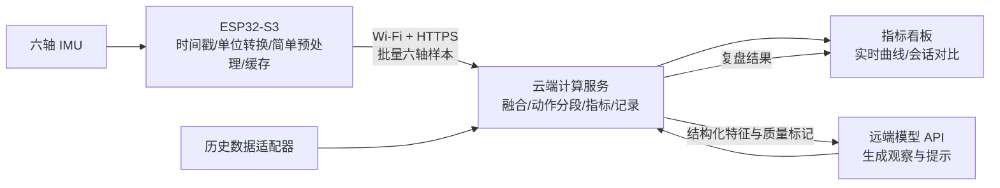

# 滑雪场景边缘穿戴设备：12–15 小时 Demo 实施方案

编制日期：2026-11-07。本文是实施设计，尚未完成板端接线、功耗测量、已有数据检查或雪场验证。时间预算按一名具备基础 Arduino/C++、Python 开发能力的开发者估算，器件到货和账号开通时间另计。

当前分工按用户补充调整：**板端完成采集和简单预处理，姿态融合、动作分段、指标计算与模型复盘主要放在云端。首版启用一颗 IMU；新增其他身体部位的观察目标后再增加节点。**

最新交互端决定：用户已接受手机网页，首版采用 **手机 H5 + 云端服务**。当前路线与物料以 [技术路线与硬件清单 v1](技术路线与硬件清单_v1.md) 为准；本文保留详细指标与算法设计参考。

## 1. 根据当前信息冻结的首版范围

| 项目 | 当前决定 |
| --- | --- |
| 产品方向 | 面向滑雪场景的通用动作监测，首版不区分单板、双板技术动作 |
| 已有主控 | ESP32-S3 N16R8；核心板厂家、引脚和电源电路待核对 |
| 已有供电 | 用户描述为 5 V、3000 mAh；先按成品 5 V 电源使用，优先接板载 USB 供电口 |
| 新增核心器件 | 一颗六轴 IMU：三轴加速度计 + 三轴陀螺仪 |
| 首选佩戴 | 腰后/骨盆附近，刚性底座固定于不易滑动的腰带；传感器坐标与身体坐标明确对应 |
| 现场环境 | 报告厅：现场新采集 + 经检查的真实历史数据回放 |
| 已有真实数据 | 来源、位置、字段、单位、采样率、标签均未确认；目前不能据此承诺训练结果 |
| 核心闭环 | 采集 → 板端时间戳/单位转换/简单预处理/缓存 → 云端融合与指标计算 → 云端模型解释 → 看板展示 |
| 首版价值 | 让动作侧倾、节奏和左右幅度差异可见，给出能追溯到数据的复盘提示 |

首版推荐名称：**“滑雪动作观察助手”**。答辩时用“通用动作指标原型”“滑雪场景复盘”，准确描述当前能力。

## 2. 现场应该呈现什么

一个 2–3 分钟的完整演示：

1. 佩戴节点，静止约 5 秒，完成陀螺零偏和中立姿态校准。
2. 做一组规律、近似对称的左右侧倾；看板同步显示侧倾角、动作事件和节奏。
3. 做一组刻意不规律或一侧幅度偏小的动作；看板展示本组与前组的数值差异。
4. 点击“生成复盘”，云端模型根据已计算的统计数值生成两条观察和一条练习提示。
5. 如历史数据检查通过，切换到“真实数据回放”，展示记录来源、时间轴及当前可计算的指标。

室内左右侧倾只是通用动作演示，页面应使用“左/右侧倾次数”或“动作事件”，不能直接显示“已完成真实滑雪转弯”。真实数据回放通过同一指标处理流程；其采集位置与实时腰部节点不同，应使用独立配置并明确展示位置。

## 3. 硬件构成与选型

### 3.1 必需物料

| 器件 | 数量 | 建议与选购确认项 |
| --- | --- | --- |
| ESP32-S3 N16R8 核心板 | 已有 1 | 复用；记录板型、USB口用途、可用 GPIO、供电方式 |
| 六轴 IMU 模块 | 1 | 默认 LSM6DS3TR-C；有成熟现货例程时也可用 LSM6DSOX；购买带引脚/接插件的模块，而非裸芯片 |
| 5 V 电源 | 已有 1 | 优先经核心板 USB 口供电；确认输出电压、线缆与 Wi-Fi 工作时稳定性 |
| 短连接线/接插件 | 1 组 | 先用 I²C；杜邦线尽量短，固定后避免接头受力；最终演示使用可靠插接或焊接 |
| 小型底板/外壳、腰带、魔术贴 | 1 组 | 首版使用现成材料；固定方向可重复，电路有绝缘，连接线有应力释放 |
| 笔记本 + 2.4 GHz 热点/路由器 | 1 套 | 板、电脑在同一局域网；电脑能够访问模型服务 |

新增采购可以先划 **200–300 元预算额度**，重点保证 IMU、连接和固定材料。这是项目预算建议，不是器件实时报价；实际按品牌、现货、运费核算。

### 3.2 IMU 数量由观测目标决定

一颗六轴 IMU 已包含三轴加速度计和三轴陀螺仪；“六轴”不是六颗传感器模块。云端计算能复用同一部位的观测生成多项指标，但不能补出未测部位的独立运动或受力。

| 启用数量 | 佩戴方案 | 新增观测与适用目标 | 本次判断 |
| --- | --- | --- | --- |
| **1 颗** | 腰后/骨盆 | 该部位的侧倾、前后倾、角运动、动作节奏及同一节点左右侧倾幅度差异 | **12–15 小时默认方案** |
| **2 颗，方案 A** | 胸部 + 腰部 | 两个部位的倾斜、相对运动及时间配合；六轴的相对航向仍有漂移问题 | 想展示上身与骨盆协调时再加；不直接输出解剖学关节角 |
| **2 颗，方案 B** | 左右小腿，或双板滑雪时左右雪靴 | 两侧角运动、动作时序和波动对比 | 想比较左右腿/雪靴时采用；没有腰部观测，不能同时声称测了躯干动作 |
| **3 颗** | 腰部 + 左右小腿/雪靴 | 在上项基础上增加腰部参考，观察身体与两侧腿部动作的时间配合 | 后续较完整方案；不列为本次必达项 |

以上是按可观测部位制定的工程方案，不是达到某个准确率的保证。用于滑雪转弯分割的研究曾采用双雪靴 IMU，但其结果不能直接迁移到通用动作或本设备。[双雪靴原始研究](https://www.frontiersin.org/journals/sports-and-active-living/articles/10.3389/fspor.2019.00018/full)。

如果目标改为膝关节屈伸，需要同时观测该腿大腿和小腿，并进行安装/功能标定；仅左右小腿两颗不能直接得到两膝关节角。双腿相应至少四个部位的 IMU 观测，也不等于不经验证就能输出准确关节角。受力分配仍需要力/压力测量。

采购可以准备两颗同型号模块，第一颗用于腰部 Demo，第二颗作备件或后续扩展；首版并不要求同时启用两颗。若两颗近距离连接同一 ESP32，LSM6DS3TR-C 可用 0x6A/0x6B 两个地址共用短 I²C 总线，具体看模块是否引出地址选择。[模块接线与地址说明](https://learn.adafruit.com/adafruit-lsm6ds3tr-c-6-dof-accel-gyro-imu?view=all)。

跨胸腰或左右腿的布线不能直接按短跳线方案外推。多部位穿戴通常应考虑多个就近采集节点或经过验证的有线链路；多个无线节点须增加时钟偏移/漂移检查、时间对齐和缺口处理。上传到达时间不能替代同步采样时间。先把节点间时间误差控制到约一个采样周期以内作为 Demo 调试目标，实际需要通过共同动作/同步触发检查。传感器数量增加不要求云端模型数量增加。

### 3.3 IMU 怎么选

| 方案 | 使用判断 | 原因与注意事项 |
| --- | --- | --- |
| **LSM6DS3TR-C 模块** | 没有既有偏好时默认选 | ST 器件；有 Adafruit Arduino 驱动和完整例程，适合快速读出六轴数据；确认模块确实使用这一型号 |
| **LSM6DSOX 模块** | 已有现货/熟悉库时同样合适 | 有官方资料和现成 Arduino 驱动；本项目不依赖其片内机器学习功能 |
| **BMI270 模块** | 已有稳定例程则复用 | 面向穿戴的六轴 IMU；初始化与库接口按具体模块确认，不在赛中同时维护多款驱动 |
| 已有其他六轴模块 | 30–45 分钟内能稳定输出则优先复用 | 重点是稳定六轴、时间戳和单位，型号性能差距通常不是此 Demo 的主要瓶颈；此为工程判断 |
| BNO085 等自带融合模块 | 不作为本次默认采购 | 自带姿态可节省部分算法工作，但需核对接口和 SDK；厂商指南记录过 I²C 时序/时钟拉伸兼容问题 |

LSM6DS3TR-C 支持 ±2/4/8/16 g 和最高 ±2000 °/s 的量程；驱动有明确的芯片型号选择，不能把名称相近的器件当作完全兼容。[ST 产品说明](https://www.st.com/en/mems-and-sensors/lsm6ds3tr-c.html)、[Adafruit Arduino 接入指南](https://learn.adafruit.com/adafruit-lsm6ds3tr-c-6-dof-accel-gyro-imu/arduino)。LSM6DSOX 的 104/208 Hz 等输出档位见 [ST 数据手册](https://www.st.com/resource/en/datasheet/lsm6dsox.pdf)。BMI270 选型信息见 [Bosch 产品说明](https://www.bosch-sensortec.com/en/products/motion-sensors/imus/bmi270)。BNO 系列兼容性应结合具体 SDK 判断，不能一概认为不可用，参考 [Adafruit 接口说明](https://learn.adafruit.com/i2c-addresses/troublesome-chips)。

### 3.4 接线原则

首版只接四根线：

| IMU 端 | 主控端 | 说明 |
| --- | --- | --- |
| VCC/VIN | 经模块说明确认的 3V3 | 采用 3.3 V 逻辑；模块电源接口与裸芯片电源要求需区分 |
| GND | GND | 共地 |
| SDA | `SDA_PIN` | 核心板型号确认后选一根空闲可用 GPIO |
| SCL | `SCL_PIN` | 同上；固件显式配置引脚 |
| 可选 DRDY/INT | 另一根空闲输入 GPIO | 有可靠例程时启用；也可先通过 data-ready 状态轮询 |

I²C 先用 100 kHz 排障，稳定后可设 400 kHz。上拉应接向 3.3 V；检查模块是否已有上拉，避免多块模块并联造成过强上拉。按模块说明设置地址/接口模式，不能只凭商品通用图片接线。

**不根据“N16R8”直接指定 SDA/SCL 脚号。**该命名在官方 WROOM-1 对应 16 MB Flash、8 MB Octal PSRAM，但不是完整的开发板型号。部分 Octal 存储配置占用 GPIO35–37，不能因为排针上存在就用于传感器。[WROOM-1 数据手册](https://www.espressif.com/sites/default/files/documentation/esp32-s3-wroom-1_wroom-1u_datasheet_en.pdf)、[官方开发板引脚说明](https://documentation.espressif.com/api/resource/path/docs/projects/esp-dev-kits/en/latest/esp32s3/esp32-s3-devkitc-1/user_guide_v1.0.html)。

### 3.5 供电和佩戴

已知电源输出为 5 V 时，优先走核心板标明支持的 USB 供电口。5 V 不接 3V3 引脚。若使用排针供电，必须先核对该核心板标注的 5V/VBUS 输入路径。先用 USB 调通全部链路，再用现有电源连续运行至少 30 分钟。

“3000 mAh”可能指内部电芯容量，也可能指输出侧额定容量；两者对应能量不同，现有信息不足以承诺续航。测得功耗后按 `运行时长 ≈ 可用输出能量 Wh / 实测平均功率 W` 估算，并用连续运行验证。首版验收重点是完整演示与 30 分钟稳定性，不把未经测量的小时数写进宣传。

腰后/骨盆附近是本次通用动作方案的工程选择。相关高山滑雪研究为骨盆位置提供过依据，但其中一项研究只涉及一名专业运动员，不能据此声称适合所有人、所有雪况。[原始研究](https://www.mdpi.com/1424-8220/16/4/463)。若改成腕部，指标应改称腕部动作；若改成雪靴，腰部的阈值和姿态解释需重新验证。

### 3.6 本轮不加入的器件及未来触发条件

| 后续能力 | 所需硬件/信息 | 为什么留到后续 |
| --- | --- | --- |
| 速度、距离、轨迹 | GNSS，或有清晰时间同步的手机定位 | 室内报告厅无法稳定演示定位；单颗 IMU 积分不能可靠长期提供这些量 |
| 相对海拔/落差 | 气压计，如 BMP390 | 要处理参考气压、天气和安装通气；对当前动作闭环价值较小 |
| 双腿差异、相对关节运动 | 多个同步节点 | 增加同步、安装和标定工作；双 IMU 的相对角也不自动等于雪板相对雪面角 |
| 双脚承重分配 | 经校准的压力/力传感器 | 姿态与受力并不等价，不能用腰部侧倾替代承重比例 |
| 振动提醒 | 马达 + 驱动器件 | 先完成看板和复盘；马达工作会污染 IMU，需标记提醒时段 |
| 本地屏幕 | 小 OLED | 现场主要看投屏；若已有则只显示连接/电量/会话状态 |

GNSS 模块示例见 [u-blox MAX-M10S 数据手册](https://content.u-blox.com/sites/default/files/MAX-M10S_DataSheet_UBX-20035208.pdf)，更新率和精度条件随配置而变，规格值不能直接当作本设备的实测表现。气压计用途见 [Bosch BMP390 产品说明](https://www.bosch-sensortec.com/en/products/environmental-sensors/pressure-sensors/bmp390)。

## 4. 指标定义：先展示哪些数值

所有阈值均为 **Demo 初始参数**，不是滑雪技术规范或医学界限。它们应通过现场新采集的小样本调试，并记录参数版本。`null` 表示条件不足，不显示为 0。

### 4.1 首版必须完成

| 指标 | 明确定义 | 更新和样本要求 | 展示意义与边界 |
| --- | --- | --- | --- |
| 会话时长 | 手动开始至结束的单调时钟差 | 1 Hz；开始/暂停状态明确 | 是记录时长，不能直接命名为“有效滑雪时间” |
| 相对侧倾角 | 安装坐标转换、姿态融合后，相对本次中立姿态的 roll | 内部约 104 Hz，显示约 10 Hz | 腰部侧倾估计；不是雪板立刃角；持续动态加速度会增加误差 |
| 左/右侧倾事件数 | 满足阈值、持续时间并返回中立的单侧完整动作 | 事件完成后计数 | 室内动作计数；真实滑雪转弯检测需要雪场标签验证 |
| 动作节奏 | 相邻有效交替事件峰值时刻之差 `T_i`；频率 `60 / mean(T_i)` | 最近 60 秒；至少 6 个有效间隔 | 单位“单侧动作/分钟”；左右一对是两个动作，避免口径混淆 |
| 节奏变异系数 CV | `100 × std(T_i) / mean(T_i)` | 至少 6 个有效间隔；停顿/缺口跨越的间隔剔除 | 描述本段节奏离散程度；更低不自动代表滑雪水平更高 |
| 左右幅度差异 | 以每次动作的最大绝对侧倾角作幅度；`A = 100 × |μL − μR| / (μL + μR)` | 最近 60 秒；左右各至少 5 个有效事件，且分母明显大于零 | 0–100%；同时显示左右均值、样本数和偏向；不是左右腿受力比例 |
| 数据质量状态 | 校准状态、采样缺口、量程饱和、陈旧时长、姿态有效标记 | 1 Hz | 数据不足时抑制相关指标和建议，避免把链路故障解释成动作问题 |

首屏以 **侧倾角、动作数、节奏、左右幅度差异** 四张卡为主，CV 放在节奏卡详情；质量状态放在顶部。增加指标数量不应影响这四项完成度。

### 4.2 有余量再加

| 指标 | 定义 | 边界 |
| --- | --- | --- |
| 前后倾估计 | 相对中立姿态的 pitch | 腰部前后倾，不是髋/膝关节角；不直接判断“后坐” |
| 加速度模长峰值 | `max(sqrt(ax²+ay²+az²) / 9.80665)` | 单位 g；静止约 1 g，表示节点测得的比力模长，不是冲击力、膝关节载荷或伤害概率 |
| 角运动高频残差 RMS | `ω − LPF_3Hz(ω)` 的向量 RMS，单位 °/s | 只是该配置下的动作波动代理，易受安装和噪声影响；首版不称为科学“稳定性分数” |
| 个人基线变化 | 同一人、同一安装位置、相近动作任务，比较两组 CV 和幅度差异 | 报告变化值，不能推断因果或疲劳程度 |

首版不提供绝对航向、惯性轨迹、真实雪面坡度、精确转弯半径、卡路里、疲劳度、技能等级或伤害风险评分。它们需要额外观测、个体模型或专门验证。

## 5. 板端采集与云端算法

### 5.1 初始配置

| 配置 | 建议值 | 调整理由 |
| --- | --- | --- |
| IMU ODR | 104 Hz（LSM 系列） | 读实际新样本；不要以 100 Hz 循环重复读出 104 Hz 数据后仍按固定 10 ms 积分 |
| 加速度量程 | ±8 g | 室内动作与一般记录的起始配置；如出现饱和则改 ±16 g 并更新元数据 |
| 陀螺量程 | ±1000 °/s | 起始配置；饱和时改 ±2000 °/s，不以削顶信号继续生成角度结论 |
| 传感器前端低通 | 约 20 Hz；以实际可配置档位为准 | 板端只做必要前端处理；云端动作分段可另使用约 3 Hz 的平滑侧倾信号 |
| 原始数据单位 | 加速度 m/s²，角速度 °/s | 驱动如返回 rad/s，显式乘 `180/π`；融合库入口另外核对所需单位 |
| 时间戳 | 64 位单调微秒时间 | 采样时打戳；HTTP 到达时间只用于网络延迟观察 |
| 设备上传 | 保留约 104 Hz 六轴样本，每 100–200 ms 批量上传 | 传原始观测供云端融合，不在上传前只保留 10 Hz 显示数据 |
| 云端姿态显示输出 | 10 Hz | 云端逐样本融合后再降低页面显示频率 |
| 云端特征输出 | 1 Hz + 事件完成即更新 | 与回放采用同一融合、分段和统计程序 |

可用 `esp_timer_get_time()` 读取启动以来的单调微秒时间；重启/深睡唤醒会重新起算，因此同时记录 `boot_id`。[Espressif ESP Timer 文档](https://docs.espressif.com/projects/esp-idf/en/stable/esp32s3/api-reference/system/esp_timer.html)。

### 5.2 校准与坐标：零偏可在板端，中立姿态在云端

1. 固定设备，定义身体坐标：x 向前、y 向左、z 向上；云端按安装配置做带符号的轴映射。
2. 静止约 5 秒，检测角速度和加速度波动是否足够小；通过后取陀螺均值作为零偏。可由板端估计并上传校准值，或统一在云端处理，不能重复扣除。
3. 云端记录中立姿态，按姿态库的四元数约定计算相对旋转；避免未核对约定就交换乘法顺序。
4. 做一次左侧倾、前倾，确认界面方向，保存 `mount_profile` 和 `calibration_id`。
5. 改变安装位置、出现明显松动或更换量程后，重新开始对应记录与校准。

5 秒校准不等于完整的加速度六面标定或温度补偿。若中立时数值不稳定，先检查安装、单位和数据更新，再调整滤波参数。

### 5.3 云端姿态融合

在云端计算服务中复用成熟的六轴 AHRS，例如 x-io Fusion，按其例程核对坐标系、单位和实际 `dt`。逐样本保持设备/传感器各自的融合状态，不能把网络批次当作一个采样点。其加速度拒绝机制有助于减轻动态加速度影响，但长时间持续加速度仍会影响估计，六轴配置没有长期绝对航向约束。[官方库与算法说明](https://github.com/xioTechnologies/Fusion)。

只用 `atan2` 从加速度计算角度，适合静态检查，不足以支撑动态滑雪姿态。只积分陀螺则会随时间漂移。若现有熟悉的融合库更容易接通，优先采用已经验证的方案，避免在赛中比较多种算法。

长采样缺口后重置相关滤波/分段状态，标记恢复期；不要用一个很大的 `dt` 直接连接断点两端并输出完整动作。

### 5.4 云端侧倾事件状态机

首版只检测通用侧倾动作：

```text
NEUTRAL
  ├─ 侧倾超过左侧进入阈值并持续 200 ms → LEFT_ACTIVE
  └─ 侧倾超过右侧进入阈值并持续 200 ms → RIGHT_ACTIVE

LEFT_ACTIVE / RIGHT_ACTIVE
  ├─ 跟踪本次峰值幅度、峰值时刻和有效样本
  ├─ 返回中立区并持续 100 ms → 完成本次事件，回到 NEUTRAL
  └─ 超时、失效、长缺口 → 丢弃本次候选并回到待恢复状态
```

初始参数：进入阈值 `±8°`，退出中立区 `±3°`，有效动作总时长 `0.4–6 s`。进入与退出采用不同阈值以避免抖动重复计数。这些数值只用于启动调试，实际应让三组演示动作和负例决定是否调整。

一次动作须从中立出发并回到中立；直接从一侧跨到另一侧时，完成前侧后，另一侧重新满足持续条件再进入。连续同侧事件可以记录，但节奏统计只使用符合交替条件的相邻事件；停顿超过设定上限、暂停、缺口时断开节奏序列。事件时间保存峰值时刻，同时保存完成时刻；界面计数要等事件完成，不能把完成延迟误当成采样延迟。

当数据质量不合格、姿态被标为无效或幅度接近噪声时，侧倾、计数和后续统计分别降级。角速度/加速度流仍可记录，不能因为暂停姿态结论就丢掉排障数据。

高山滑雪研究存在基于雪靴陀螺的转弯分割方法，但设备位置、动作类别和验证条件不同。本方案的腰部室内状态机没有复现那些研究精度。[雪靴 IMU 原始研究](https://www.frontiersin.org/journals/sports-and-active-living/articles/10.3389/fspor.2019.00018/full)。

### 5.5 采集、通信分开执行

板端采集任务：等新样本/DRDY → 读六轴 → 时间戳 → 单位转换/可选零偏扣除 → 饱和与采样缺口标记 → 有界队列。板端可使用传感器硬件低通；首版不要求在板端运行 AHRS、动作分段或评分。

通信任务：读取队列 → 批量发送 → 超时重试/去重 → 记录队列溢出。采集任务不能等待 HTTP、DNS 或模型返回；中断回调只做通知，不直接读网络、写文件或运行大段处理。

云端处理任务：校验/去重/按采样时间排序 → 逐样本融合 → 动作分段 → 窗口指标 → 页面更新/模型复盘。重传历史样本先补入记录或重新计算对应区间，不能在已经推进的实时融合状态尾部倒序追加。

推荐内存估算：若原始记录按 32 字节封装，`104 × 32 ≈ 3.3 kB/s`，60 秒约 0.20 MB，10 分钟约 2.0 MB。三颗 IMU 则约 10 kB/s 二进制载荷；JSON 和协议开销另计。这是指定记录格式的估算，不是实测带宽。启动先检查 PSRAM 确实可用；如果启用失败，用较短缓冲继续演示。队列满时记录丢弃区间，不能声称无限断网缓存。持久记录先写到云端 JSONL，调试时可镜像到电脑；避免逐样本写设备 Flash。

`seq` 用于检测传输缺失/重复；采样缺口还要检查实际时间间隔、DRDY/FIFO 状态。只给每次成功读取递增 `seq`，无法发现读取前已经漏掉的传感器样本。

## 6. 边缘、后端与云端模型的分工



建议 ESP32 连接普通 2.4 GHz 热点并访问云端 HTTPS 接口，电脑负责访问看板/投屏；排障时可在同一局域网运行相同计算服务。S3 支持 Wi-Fi 和 BLE；本次只实现一条 Wi-Fi 主链路。[芯片产品信息](https://www.espressif.com/en/products/socs/esp32-s3)、[Arduino Wi-Fi API](https://docs.espressif.com/projects/arduino-esp32/en/latest/api/wifi.html)。

### 6.1 推荐的软件实现

| 层 | 首版选择 | 必须完成的行为 |
| --- | --- | --- |
| 固件 | Arduino/C++，使用现有熟悉的构建环境 | IMU 驱动、单调时间戳、单位转换、可选零偏、质量标记、网络队列 |
| 云端计算后端 | Python FastAPI + 融合/统计模块 | 收六轴数据、校验、姿态融合、动作分段、窗口统计、模型转发、JSONL记录与回放 |
| 页面 | 后端提供的单页 HTML/JS | 4 张主卡、侧倾曲线、事件标记、质量状态、复盘按钮 |
| 设备上行 | HTTPS 批量 POST | 每 100–200 ms 一批约 104 Hz 的六轴样本，包含 sensor_id、采样时间、seq、单位/校准版本及质量标记 |
| 页面更新 | 先用约 200 ms 轮询 | 对一个设备足够简单；已有成熟代码再用 WebSocket |
| 云端模型 | 已可访问的模型 API | 每段动作结束或用户点击后生成复盘；不放进实时采样链路 |
| 数据存储 | 云端 JSONL + 会话元数据 | 调试时可本地镜像；无需先搭数据库、账号系统或消息中间件 |

FastAPI 适合实现带请求校验和 API 文档的小型后端，参考 [官方文档](https://fastapi.tiangolo.com/)。本方案的具体架构和时间预算为工程设计，不是框架性能保证。

**部署口径：**目标为“板端轻预处理 + 云端姿态/指标计算 + 远端模型复盘”，笔记本负责调试和投屏。12 小时时间表假设已有可用云账号/托管环境，网络、证书和接口可达性检查计入上报阶段。可先在电脑运行同一服务调通，再部署云端；如最终只能在电脑计算，应如实标为本地后端演示，不能声称姿态和统计已经在云端运行。断网时板端继续有界缓存，云端实时指标显示断流，恢复后按采样时间补算。

### 6.2 原始上行字段与云端计算摘要

建议接口只有四个：`POST /api/batches`、`GET /api/session`、`POST /api/review`、`POST /api/replay`。具体路径是本方案自定义，并非云服务的固定接口。

设备上行的每条样本至少包含 `sensor_id`、`seq`、`t_us`、`ax/ay/az`、`gx/gy/gz` 和 `quality_flags`，批次元数据带 `device_id`、`boot_id`、`session_id`、量程、单位、安装与校准版本。保留校准前后口径，供云端核对。

下例是**云端计算完成后提供给页面/语言模型的虚构摘要**，不是设备必须计算的内容，也不是用户已有数据或实测结果：

```json
{
  "schema_version": 1,
  "device_id": "demo-node-01",
  "boot_id": "boot-example",
  "session_id": "session-example",
  "source": "live",
  "mount_profile": "waist_xyz_v1",
  "calibration_id": "cal-example",
  "parameter_version": "demo-v1",
  "window_start_us": 10000000,
  "window_end_us": 70000000,
  "n_left": 6,
  "n_right": 6,
  "n_valid_intervals": 11,
  "mean_event_interval_s": 2.0,
  "rhythm_cv_pct": 25.0,
  "left_mean_peak_deg": 18.0,
  "right_mean_peak_deg": 12.0,
  "amplitude_asymmetry_pct": 20.0,
  "quality": {
    "calibrated": true,
    "sample_coverage_pct": 99.0,
    "saturated": false,
    "orientation_valid": true
  }
}
```

另存原始样本的时间、六轴数值、量程、标称/实测采样率和缺口。原始采集与实时显示可以用不同频率，不能将 10 Hz 看板输出误称为原始 104 Hz 完整记录。

实时传输按 `(device_id, boot_id, sensor_id, seq)` 去重。跨设备/外部视频同步需要独立对时；现阶段单节点指标以设备时间为准。模型 API Key 放后端环境变量，板端和网页只持有本 Demo 所需的设备访问凭证；公网接入使用 HTTPS。

### 6.3 云端模型做什么

数值由确定的计算程序得到，模型接收特征摘要后负责解释、排序关注点、生成易懂的复盘。首版无需训练专用深度学习模型。

模型输出只保留：`observations`（最多两条）、`evidence`（对应指标和值）、`next_step`（一条提示）、`limitations`（当前数据不足）。后端校验返回格式，涉及数值的内容从指标记录回填/核对；格式错误或超时则返回基于同一特征的规则摘要。

推荐输入约束：

> 你是动作记录复盘助手。只依据提供的指标、样本数、采集位置和质量状态描述本段动作。每条观察关联输入证据。不得补造速度、雪板立刃角、受力、疲劳或技能等级；不得从腰部角度推断具体膝关节问题。数据不足时明确说明。当前为室内通用动作演示，练习提示限于重复相同任务、关注节奏和两侧幅度，并建议在有视频或教练反馈时进一步核验。

示例解释：“本组右侧倾平均幅度比左侧小；记录为左侧 18°、右侧 12°。可以再做一组慢速对称侧倾，比较幅度差异是否仍然存在。”这是对可观测量的反馈；不能据此改写成“右腿力量弱”或“右转技术错误”。

规则阈值可用 CV > 20%、幅度差异 > 15% 作为调试时的关注标记，但应显示“Demo 参数”，不称为优秀/合格界限。相同动作任务下优先比较个人两组记录，而非套用全人群评分。模型调用目标为一次复盘约 10 秒内返回；超时降级，实际速度按服务验证。

## 7. 已有真实数据：30 分钟检查后决定用途

当前还没有查看文件，不能判断是否足够训练。第一次检查只解决以下问题，不做长时间清洗工程：

| 时间 | 检查 | 结果如何影响计划 |
| --- | --- | --- |
| 0–10 分钟 | 能否打开；字段、时间单位、时间连续性、实际采样间隔、记录时长 | 确定可用数据列和缺口；采样率从时间戳估计，不按文件名猜测 |
| 10–20 分钟 | 加速度/陀螺单位、是否去重力、坐标、佩戴位置、人数与会话 | 无法确认单位/坐标时仅展示原始曲线，不生成物理角度和技术结论 |
| 20–30 分钟 | 是否有动作标签或同步视频、是否有独立记录可留作验证 | 决定是回放、规则调参，还是额外做分类器 |

三种落地结果：

- **有时间戳与六轴数据，位置/单位可确认但无标签：**真实回放、观察分布、检查算法输出；不报告动作识别准确率。
- **有可靠标签、位置一致且有独立录制片段：**可在 12 小时闭环完成后，尝试特征 + 小型树模型进行探索性分类；类别由真实标签决定。
- **字段/单位/位置无法确认或关键数据缺失：**保存为待分析素材；正式现场链路使用新节点采集的可追溯数据。

数据是否足够不能只看“有多少行”。同一连续动作切出很多重叠窗口，并不等于拥有很多独立样本。若做分类器，先按人或独立会话分组划分训练/测试，再切窗；标准化参数只在训练集拟合。来自同一条记录的相邻重叠窗口不能随机分散到训练和测试两边。[scikit-learn 数据泄漏说明](https://scikit-learn.org/stable/common_pitfalls)。

若只有一个人，多段数据最多支撑“这个人的初步实验”；若旧数据在脚踝、新设备在腰部，也不能直接宣称模型迁移有效。没有独立测试记录就不写泛化准确率。黑客松的默认方案不依赖这个分类器完成。

## 8. 12 小时执行表与 3 小时余量

| 相对时间 | 工作 | 必须留下的可检查结果 |
| --- | --- | --- |
| 0–0.5 h | 检查已有数据、确认板型/电源/IMU；冻结指标与单位 | 一页数据检查记录 + 首版物料/参数表；旧数据不明则按上述降级 |
| 0.5–2 h | IMU 接线、驱动、时间戳、静态与方向检查 | 连续六轴日志；静止模长约 1 g；左右/前后方向正确 |
| 2–4 h | 板端队列/预处理，计算服务实现校准、姿态、动作事件 | 先以串口记录驱动同一计算模块；静止不持续计数；左右可重复演示 |
| 4–5.5 h | Wi-Fi/HTTPS 上报、云端部署、接收与 JSONL | 云端收到真实设备样本并运行融合；网络请求不阻塞板端采集 |
| 5.5–7 h | 看板与窗口统计 | 四张主卡、曲线、质量状态；CV/左右差异样本不足时为 null |
| 7–8 h | 云端模型接入与规则回退 | 摘要请求可返回复盘；模型无响应时仍展示指标和明确的规则摘要 |
| 8–9.5 h | 真实数据适配/回放；没有可用旧数据则用本节点录制的室内数据 | 同一处理接口可重复回放；来源标记正确 |
| 9.5–11 h | 连续稳定性、断网恢复、计数/公式检查 | 一份带结果的验收记录，修复影响主流程的问题 |
| 11–12 h | 固定外壳、投屏与讲稿、完整彩排、备份视频 | 2–3 分钟完整演示；本地回放和视频均可用 |

12–15 小时余量按优先级使用：

1. 先修复剩余稳定性/网络问题，补测现有 5 V 电源和固定方式。
2. 已有数据明确可用时，增加真实记录对比，完善云端断流状态与重传补算。
3. 所有必达项完成且有可靠标签时，才尝试一个额外动作分类器。

云部署属于本次目标；分类训练、新屏幕和多节点属于可选扩展，按当时证据只选最有价值的一项。

### 8.1 明确的止损点

| 到达时间/条件 | 动作 |
| --- | --- |
| 2 小时仍不能稳定读 IMU | 优先换手头有稳定例程的模块/检查供电与地址；暂停额外器件和算法比较 |
| 5.5 小时 Wi-Fi 仍影响演示 | 使用 USB 串口 → 电脑转发，继续接云端模型；在答辩中说明本次采用有线调试链路 |
| 模型服务不可达 | 保留规则摘要并标明来源；提前记录的真实模型输出仅作为历史结果展示，不能伪装成实时返回 |
| 历史数据 30 分钟仍不明确 | 主流程转为新节点的实时与录制回放，保留原数据待后续分析 |
| 到 10 小时主闭环仍不完整 | 冻结可选功能，专注实时采集、四项指标、可追溯反馈与彩排 |

## 9. 验收标准：哪些能在黑客松内证明

以下都是目标，完成后逐项写实际结果，不能预填“通过”。

| 验收项 | 方法 | 首版目标 |
| --- | --- | --- |
| 六轴与方向 | 静止、缓慢左右侧倾、前后倾、转动 | 单位与方向一致；静止加速度模长合理；没有重复旧样本当新样本 |
| 静态角度 | 用已知倾角夹具/参考倾角仪做 0°、±15°、±30° 慢速静态检查 | 选定静态点误差目标约 3°以内；只报告实测值，不代表动态滑雪精度 |
| 动作计数 | 单独调试后，录制三组各 20 次左右侧倾作为保留验证片段 | 每组目标计数误差不超过 2 次，同时检查误报/漏报，不能只用净计数抵消 |
| 事件识别口径 | 人工标峰值，与预测一对一匹配；初始匹配容差 ±0.3 s | 记录 TP/FP/FN，给出 precision/recall；这是室内任务结果 |
| 负例 | 静止 60 s、只抖手/走动/转身各一段 | 记录误触发；无法抑制时限制为手动启动的侧倾任务模式 |
| 公式核对 | 手工构造左右均值18°和12°；固定间隔和变间隔序列 | 幅度差异应为20%；节奏 CV 与独立计算一致；缺少样本返回 null |
| 回放一致性 | 相同记录与参数版本运行两次 | 事件数和汇总统计可复现；实时与回放采用同一指标定义 |
| 数据质量 | 注入缺口、饱和、失效、暂停 | 标记异常；不跨缺口拼接动作；不据此生成动作结论 |
| 端到端延迟 | 在设备端和网页端记录时间，单节点用对时/往返估计或视频观察辅助 | 姿态看板目标约 0.5 s 内跟随；动作计数另含完成等待时间 |
| 稳定性 | 现有 5 V 供电、完整页面和上传连续运行 30 分钟 | 无重启/明显内存增长；采样有效覆盖目标≥98%；记录实际结果 |
| 断网恢复 | 暂停热点约 10 s，再恢复 | 采集继续；有界队列工作；恢复不重复计数；超出缓存时明确记录缺口 |
| 云端复盘 | 正常摘要、样本不足、模型超时三种输入 | 输出依据可查；无捏造指标；超时明确显示规则来源 |

若使用新增三组室内记录调阈值，要另录保留验证片段，不能把反复调参的同一段当作独立测试。室内演示、历史雪场回放与未来佩戴雪场测试应分别记录结论；目前雪场测试未完成。

## 10. 展示页内容与答辩材料

页面只需一屏：顶部显示设备/连接/校准/数据来源；中间四张指标卡和一条侧倾曲线；底部显示本组与基线对比、证据及复盘文本。控制项保留开始、停止、校准、生成复盘、回放即可。

建议交付目录：

```text
firmware/                 ESP32-S3 固件和已验证配置
backend/                  接收、指标统计、模型适配与回放
dashboard/                演示页面及本地静态资源
data/raw/                 原始数据及来源说明
data/demo/                已核验演示片段、人工标注和会话元数据
docs/                     接线图、参数版本、验收结果和讲稿
demo/                     备用演示视频
```

图表脚本/字体保存在本地，避免投屏时依赖 CDN。模型请求失败与设备断线分别显示，避免将云端错误显示成传感器掉线。

答辩可以用三句话串联：

> 我们用一个低成本节点，让动作的侧倾、节奏和左右差异可观察。ESP32-S3 在本地完成采集、时间戳和简单预处理，云端计算姿态和动作指标，语言模型把可核查的指标转成复盘提示。当前已验证范围以实际验收记录为准，后续用同步视频和真实雪场记录检验这些指标与滑雪动作的关系。

## 11. 开工前最短确认表

- [ ] 确认手上六轴 IMU 型号；尚未购买则选现货、带接线说明与成熟例程的模块。
- [ ] 找到核心板正反面型号/商品说明，确定 USB 供电与两根 I²C 引脚；在此之前不按通用图指定脚号。
- [ ] 先用现有 5 V 电源的合适输出口连接核心板，不从“3000 mAh”直接推算续航。
- [ ] 默认腰部固定；采集新数据时同时记录位置、方向、单位、量程、时间和任务标签。
- [ ] 检查历史数据 30 分钟；无法确认就按现场新采集主线继续。
- [ ] 准备可用的云端计算环境、模型账号和 2.4 GHz 网络；验证六轴样本上报和一次结构化摘要请求。
- [ ] 冻结首版：四张主卡、真实采集、窗口统计、云端复盘、回放、备份视频。

## 12. 开源实现入口

已另行核对公开仓库并整理 [开源方案筛选与联调路线](开源方案筛选与联调路线.md)：主线采用 Adafruit_LSM6DS 六轴驱动 + 云端 Fusion；多节点参考 SlimeVR；滑雪数据/模型参考 SkiC-LSTM；SenzIMU 作为带非商业许可条件的多节点网页参考。具体适配差异、代码入口和当前未完成的验证见该文档。

本文所有性能、准确度、续航和工期数字都是设计目标或明确假设下的估算；已检索资料支持器件能力和方法边界，不能代替本设备的接线和测试证据。
